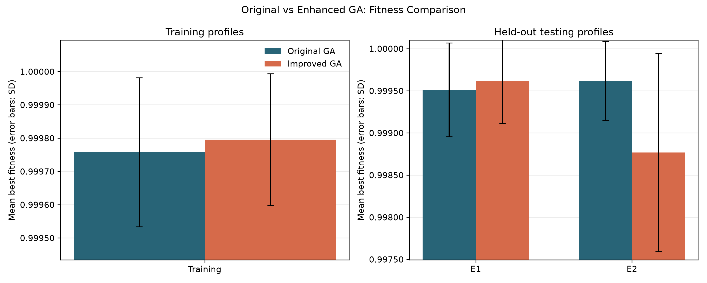
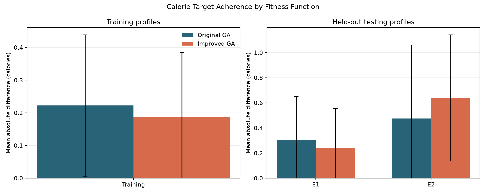
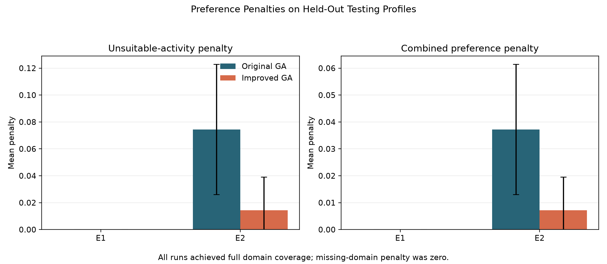
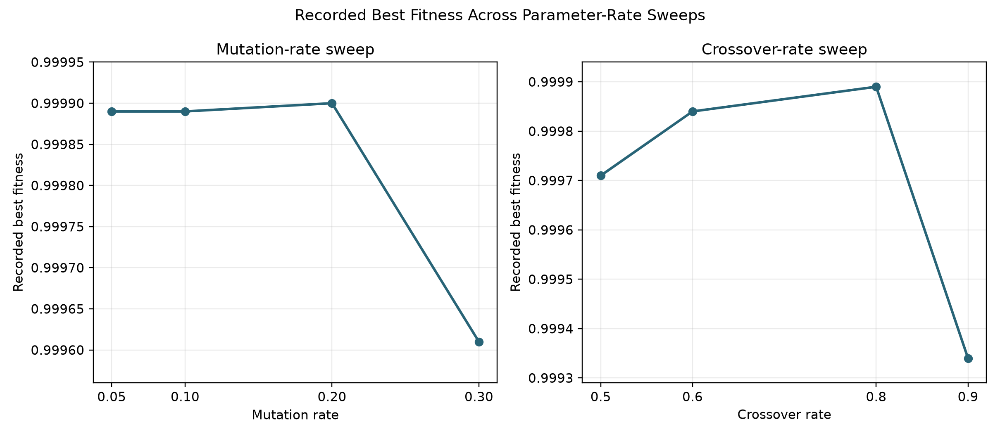

# Task 8 – Enhanced Fitness Function for Exercise Preferences

## 1. Objective

The objective of Task 8 is to improve the ACTIVEA algorithm by enhancing its fitness function to account for users' exercise preferences across seven fitness domains.

The original fitness function evaluates exercise sessions using calorie expenditure, MET, Rate of Perceived Exertion (RPE), heart rate, and domain coverage.

However, domain coverage alone does not guarantee that every selected activity is suitable for the user's intended preferences.

For example, if a user requests Cardiovascular (CV) and Flexibility (FL) exercises, an activity that supports neither domain should receive a penalty, even if the overall session achieves good calorie and physiological targets.

To address this limitation, an enhanced fitness function was implemented with two additional preference-related considerations:

1. Missing-domain penalty.
2. Unsuitable-activity penalty.

The enhanced algorithm was compared against the original fitness function using repeated experiments with training and testing profiles.

---

## 2. Seven Exercise Domains

The activity dataset contains seven exercise domains:

| Code | Exercise domain |
|---|---|
| CV | Cardiovascular |
| ST | Strength |
| ME | Muscular Endurance |
| FM | Functional Movement |
| FL | Flexibility |
| BA | Balance |
| AG | Agility |

An activity can support multiple domains.

For example:

- Jogging: CV, ME, FM
- Bodyweight squats: ST, ME, BA, FM
- Yoga: FL, BA, ME
- Rope skipping: CV, ME, AG

The domain information is stored in the `fitness_domains` column of `data/activities.csv`.

---

## 3. Original Fitness Function

The original fitness function evaluates a generated exercise session using five weighted components.

### 3.1 Fitness formula

The original fitness function is:

\[
F_{original} =
0.40C + 0.15M + 0.15R + 0.15H + 0.15D
\]

Where:

- \(C\) = Calorie score
- \(M\) = MET score
- \(R\) = RPE score
- \(H\) = Heart-rate score
- \(D\) = Domain coverage score

### 3.2 Component weights

| Component | Weight |
|---|---:|
| Calories | 0.40 |
| MET | 0.15 |
| RPE | 0.15 |
| Heart rate | 0.15 |
| Domain coverage | 0.15 |
| **Total** | **1.00** |

### 3.3 Domain coverage

Domain coverage measures how many of the user's requested domains are represented in the generated session.

\[
D = \frac{\text{Number of matched desired domains}}
{\text{Number of desired domains}}
\]

For example:

Desired domains:

CV, ST, ME, FM

Covered domains:

CV, ME, FM

Therefore:

\[
D = \frac{3}{4}=0.75
\]

### 3.4 Limitation of the original function

The original function rewards domain coverage but does not independently penalise activities that do not match any requested domain.

Consequently, an exercise session could achieve full domain coverage while still containing irrelevant activities.

This limitation motivated the enhanced fitness function.

---

## 4. Enhanced Fitness Function

The enhanced fitness function retains all five components of the original fitness function and introduces two additional penalty mechanisms.

### 4.1 Missing-domain penalty

This penalty measures the proportion of requested domains that are not represented in the generated exercise session.

\[
P_{missing}=1-D
\]

For example, if a user requests four domains and the session covers three:

\[
P_{missing}=1-0.75=0.25
\]

### 4.2 Unsuitable-activity penalty

This penalty measures the proportion of the total exercise duration allocated to activities that do not support any of the user's desired domains.

An activity is considered unsuitable when its fitness-domain labels have no intersection with the user's desired domains.

Let:

- \(t_i\) = Duration of activity \(i\)
- \(S\) = Set of desired domains
- \(A_i\) = Set of domains supported by activity \(i\)

An activity is unsuitable when:

\[
A_i \cap S = \emptyset
\]

The unsuitable-activity penalty is calculated as:

\[
P_{unsuitable} =
\frac{\sum_{i:A_i\cap S=\emptyset}t_i}
{\sum_i t_i}
\]

For example:

- Total exercise duration = 30 minutes
- Unsuitable activity duration = 10 minutes

\[
P_{unsuitable}=\frac{10}{30}=0.3333
\]

This ensures that longer unsuitable activities contribute proportionally more to the penalty.

### 4.3 Combined penalty

The implementation combines the two penalty components:

\[
P_{combined} =
\frac{P_{missing}+P_{unsuitable}}{2}
\]

### 4.4 Enhanced fitness formula

The enhanced fitness function is:

\[
F_{enhanced} =
\max(0,F_{original}-\lambda P_{combined})
\]

Where:

- \(F_{original}\) = Original fitness score
- \(\lambda\) = Penalty strength
- \(P_{combined}\) = Combined preference penalty

The experiments used:

\[
\lambda=0.10
\]

The final score is restricted to the interval [0,1].

This approach preserves the original fitness calculation while incorporating an additional preference-based penalty.

---

## 5. Chromosome Representation

The chromosome representation was retained from the original ACTIVEA implementation.

Each chromosome contains seven genes, with each gene representing the duration allocated to one activity in the activity catalogue.

For example:

```python
chromosome = [10, 5, 0, 0, 10, 0, 0]
```

This represents:

| Activity index | Allocated duration |
|---|---:|
| Jogging | 10 minutes |
| Bodyweight squats | 5 minutes |
| Cycling | 0 minutes |
| Plank | 0 minutes |
| Yoga | 10 minutes |
| Rope skipping | 0 minutes |
| Running | 0 minutes |

A zero means that the activity is not selected.

The chromosome length remains seven because the activity catalogue contains seven activities.

### Why the representation was retained

The enhanced fitness function evaluates the existing chromosome against the desired fitness domains associated with each activity.

There was no need to introduce additional genes or change the chromosome structure.

This allows the original and enhanced fitness functions to operate on the same candidate solutions and makes experimental comparisons more consistent.

---

## 6. Controlled Unsuitable-Activity Penalty Experiment

A controlled experiment was conducted to verify whether the new unsuitable-activity penalty operates correctly.

The experiment used a session containing activities that covered all requested domains but also included an activity that did not support any of those domains.

### Test profile

```python
profile = {
    "target_calories": 400,
    "met_range": (4, 7),
    "rpe_range": (4, 6),
    "hr_range": (64, 77),
    "desired_domains": ["CV", "ST", "ME", "FM"]
}
```

### Observed results

| Metric | Result |
|---|---:|
| Fitness | 0.758533 |
| Calories | 175.20 |
| MET | 4.7667 |
| RPE | 4.00 |
| Heart rate | 67.8333 |
| Domain coverage | 1.0000 |
| Missing-domain penalty | 0.0000 |
| Unsuitable-activity penalty | 0.3333 |
| Unsuitable duration | 10 minutes |
| Combined penalty | 0.1667 |
| Penalty strength | 0.10 |

### Interpretation

The session achieved full domain coverage:

\[
D=1.0
\]

Therefore:

\[
P_{missing}=0
\]

However, 10 minutes were allocated to an unsuitable activity, producing:

\[
P_{unsuitable}=0.3333
\]

The combined penalty became:

\[
P_{combined}=\frac{0+0.3333}{2}
\]

\[
P_{combined}=0.1667
\]

The additional fitness reduction was approximately:

\[
0.10 \times 0.1667 = 0.01667
\]

This experiment demonstrates that the enhanced function can penalise unsuitable activities even when all requested domains are covered.

---

## 7. Training Data Experiments

The enhanced and original fitness functions were compared using the training dataset.

### Experimental configuration

| Parameter | Value |
|---|---:|
| Population size | 30 (the default used by `improved_fitness_comparison.py`) |
| Generations | 50 |
| Crossover rate | 0.80 |
| Mutation rate | 0.10 |
| Random seeds | 10, 20, 30, 40, 50 |
| Training profiles | 4 |
| Algorithms | Original GA, Improved GA |

Each algorithm was evaluated using the same activity catalogue and training profiles.

### Training results

The following results were obtained from `improved_fitness_summary.csv`.

| Metric | Original GA | Improved GA |
|---|---:|---:|
| Mean fitness | 0.999758 | 0.999796 |
| Fitness standard deviation | 0.000224 | 0.000198 |
| Domain coverage | 1.0000 | 1.0000 |
| Combined penalty | 0.0000 | 0.0000 |
| Average calories | 375.1355 | 375.0860 |
| Average duration (minutes) | 63.35 | 62.65 |

### Training analysis

The enhanced fitness function achieved a slightly higher average fitness score.

The standard deviation was also lower, suggesting less variation in the observed fitness scores across the repeated runs.

Both algorithms achieved complete domain coverage and zero combined preference penalty in the reported aggregate results.

The average calorie expenditure was very similar between the two approaches.

The enhanced algorithm therefore demonstrated a small improvement in the training experiments, although the difference in average fitness was relatively small.

---

## 8. Testing Data Experiments

Testing experiments were conducted to evaluate how the original and enhanced fitness functions performed on profiles not used in the training dataset.

The testing dataset contained two profiles: E1 and E2.

### Experimental configuration

The same general genetic algorithm configuration was used:

- Population size: 50
- Generations: 50
- Crossover rate: 0.80
- Mutation rate: 0.10
- Random seeds: 10, 20, 30, 40, 50
- Fitness functions: Original and Improved

### 8.1 Testing profile E1

Desired domains:

FL, BA, ME

Target calories:

250

| Metric | Original GA | Improved GA |
|---|---:|---:|
| Mean fitness | 0.999514 | 0.999616 |
| Fitness standard deviation | 0.000556 | 0.000503 |
| Domain coverage | 1.0000 | 1.0000 |
| Missing-domain penalty | 0.0000 | 0.0000 |
| Unsuitable-activity penalty | 0.0000 | 0.0000 |
| Combined penalty | 0.0000 | 0.0000 |
| Average calories | 249.996 | 250.196 |
| Average duration | 63.4 | 62.0 |

#### E1 analysis

Both algorithms achieved complete domain coverage and zero preference penalties.

The improved GA achieved a slightly higher average fitness score.

Calorie expenditure was also very close to the target of 250 calories.

The improved GA exceeded the target by approximately 0.196 calories, while the original GA was approximately 0.004 calories below the target.

Both approaches demonstrated good performance for this profile.

### 8.2 Testing profile E2

Desired domains:

CV, ST, AG, FM

Target calories:

500

| Metric | Original GA | Improved GA |
|---|---:|---:|
| Mean fitness | 0.999619 | 0.998770 |
| Fitness standard deviation | 0.000469 | 0.001176 |
| Domain coverage | 1.0000 | 1.0000 |
| Missing-domain penalty | 0.0000 | 0.0000 |
| Unsuitable-activity penalty | 0.074419 | 0.014370 |
| Combined penalty | 0.037209 | 0.007185 |
| Average calories | 499.616 | 499.996 |
| Average duration | 68.0 | 67.4 |

#### E2 analysis

Both algorithms achieved complete coverage of the requested domains.

However, the enhanced GA substantially reduced the unsuitable-activity penalty.

The unsuitable-activity penalty decreased from approximately 0.07442 to 0.01437.

The combined penalty also decreased from approximately 0.03721 to 0.00718.

This indicates that the enhanced fitness function encouraged the algorithm to select exercise sessions with a lower proportion of unsuitable activities.

However, the enhanced GA achieved a lower mean fitness score and a higher standard deviation than the original GA.

This is an important observation: reducing unsuitable activities does not necessarily produce a higher overall fitness score when the original fitness components and penalty mechanism are considered together.

The enhanced GA's mean achieved calories (499.996) were closer to the target than the original GA's mean (499.616). However, the enhanced GA had a higher average run-wise absolute calorie error (0.640 versus 0.476 calories; see Section 11.1), reflecting greater variation across its five runs.

---

## 9. Overall Training and Testing Comparison

The experiments demonstrate different behaviours across the training and testing profiles.

| Observation | Training | E1 | E2 |
|---|---|---|---|
| Domain coverage | Full | Full | Full |
| Preference penalty | Zero | Zero | Reduced by enhanced GA |
| Enhanced fitness | Slightly higher | Slightly higher | Lower |
| Calorie target adherence | Similar | Very close | Enhanced mean closer; original has lower run-wise absolute error |
| Enhanced GA consistency | Slightly better | Slightly better | More variable |

The most important finding is that the enhanced fitness function has a measurable effect on activity selection.

In particular, the E2 results show that the unsuitable-activity penalty can reduce the duration allocated to activities outside the user's requested domains.

However, the effect on overall fitness is profile-dependent.

---

## 10. Unit Testing and Validation

Unit tests were executed using:

```powershell
python -m pytest -v
```

The final reported test result was:

```text
10 passed in 5.33s
```

The tests covered:

1. Calorie calculation.
2. Range scoring within the preferred range.
3. Range scoring outside the preferred range.
4. Full domain coverage.
5. Partial domain coverage.
6. Required fitness metrics.
7. Fitness score boundaries.
8. Zero-duration chromosome.
9. Application of the improved fitness penalty.
10. Penalisation of missing desired domains.

---

## 11. Expanded Algorithm Comparison

This section compares the original fitness function with the enhanced (also named "Improved GA" in the result files) fitness function. It uses the recorded repeated-run CSV files; no genetic algorithm experiments were rerun. Fitness standard deviations below are sample standard deviations across runs, and best fitness is the highest recorded run value. Calorie error is the mean absolute difference between each run's achieved calories and its profile target, not the difference between the two group means.

The training comparison contains four profiles and five seeds per profile. Its script uses the GA defaults: population size 30, 50 generations, crossover rate 0.8, and mutation rate 0.1. The testing comparison contains two held-out profiles and five seeds per profile, with population size 50 and the same generation and rate settings. The training and testing results are therefore reported separately and are not treated as identical configurations.

### 11.1 Original and Enhanced GA Performance

| Split / profile | Fitness function | Mean fitness (SD) | Best observed fitness | Target / achieved calories | Mean absolute calorie difference | Mean duration (minutes) |
|---|---|---:|---:|---:|---:|---:|
| Training (T1-T4) | Original GA | 0.999758 (0.000224) | 0.999991 | 375.000 / 375.136 | 0.223 | 63.35 |
| Training (T1-T4) | Enhanced GA | 0.999796 (0.000198) | 0.999991 | 375.000 / 375.086 | 0.188 | 62.65 |
| Testing (E1) | Original GA | 0.999514 (0.000556) | 0.999968 | 250.000 / 249.996 | 0.304 | 63.40 |
| Testing (E1) | Enhanced GA | 0.999616 (0.000503) | 0.999968 | 250.000 / 250.196 | 0.240 | 62.00 |
| Testing (E2) | Original GA | 0.999619 (0.000469) | 0.999984 | 500.000 / 499.616 | 0.476 | 68.00 |
| Testing (E2) | Enhanced GA | 0.998770 (0.001176) | 0.999888 | 500.000 / 499.996 | 0.640 | 67.40 |

The reported domain coverage and preference penalties are:

| Split / profile | Fitness function | Desired-domain coverage | Missing-domain penalty | Unsuitable-activity penalty | Combined penalty |
|---|---|---:|---:|---:|---:|
| Training (T1-T4) | Original GA | 1.000 | 0.000000 | 0.000000 | 0.000000 |
| Training (T1-T4) | Enhanced GA | 1.000 | 0.000000 | 0.000000 | 0.000000 |
| Testing (E1) | Original GA | 1.000 | 0.000000 | 0.000000 | 0.000000 |
| Testing (E1) | Enhanced GA | 1.000 | 0.000000 | 0.000000 | 0.000000 |
| Testing (E2) | Original GA | 1.000 | 0.000000 | 0.074419 | 0.037209 |
| Testing (E2) | Enhanced GA | 1.000 | 0.000000 | 0.014370 | 0.007185 |







### 11.2 Interpretation

- On the training profiles, the enhanced function has a slightly higher mean fitness (0.999796 versus 0.999758), lower observed standard deviation, and lower mean absolute calorie error (0.188 versus 0.223 calories). Both variants reached the same best observed fitness and full domain coverage; all recorded preference penalties were zero.
- On E1, the enhanced function has a slightly higher mean fitness and lower mean absolute calorie error. Both variants achieved full coverage with no recorded penalties.
- On E2, the original function has higher mean and best fitness, lower fitness variation, and lower mean absolute calorie error. The enhanced function has substantially lower unsuitable-activity and combined penalties: the unsuitable-activity penalty falls from 0.074419 to 0.014370. Thus the preference penalty improves the recorded activity-suitability metric on E2, but the enhanced run does not lead on every overall performance metric.
- Every recorded training and testing run has full desired-domain coverage and zero missing-domain penalty. Those metrics do not distinguish the two fitness functions in these datasets. The measurable preference-penalty difference is confined to unsuitable activity in E2.

The scores are close to the upper bound and the testing sample contains only two profiles with five seeds each. These results are descriptive; they do not establish statistical significance or universal superiority of either fitness function.

### 11.3 Mutation- and Crossover-Rate Experiments

The existing rate sweeps report one run per setting with seed 42, population size 50, and 50 generations. The values below are the recorded best fitness and total duration; they identify the best observed setting in these sweeps, not a statistically established optimum.

| Mutation rate | Best fitness | Duration (minutes) |
|---:|---:|---:|
| 0.05 | 0.999890 | 60 |
| 0.10 | 0.999890 | 67 |
| 0.20 | 0.999900 | 64 |
| 0.30 | 0.999610 | 73 |

| Crossover rate | Best fitness | Duration (minutes) |
|---:|---:|---:|
| 0.50 | 0.999710 | 76 |
| 0.60 | 0.999840 | 80 |
| 0.80 | 0.999890 | 67 |
| 0.90 | 0.999340 | 71 |

Among the tested mutation rates, 0.20 produced the highest recorded fitness (0.999900). Among the tested crossover rates, 0.80 produced the highest recorded fitness (0.999890) and the shortest duration in that sweep. The difference between mutation rates 0.05, 0.10, and 0.20 is small; repeated trials would be needed before changing defaults on that basis.



The separate repeated mutation-operator comparison used 20 training runs per operator and reports:

| Mutation operator | Mean fitness | Fitness SD | Mean final diversity |
|---|---:|---:|---:|
| Original Mutation | 0.999758 | 0.000224 | 0.151999 |
| Two-Scale Mutation | 0.999881 | 0.000097 | 0.065474 |

Two-Scale Mutation has the higher mean fitness and lower fitness variation in these runs, alongside lower final diversity. This operator comparison is distinct from the single-run mutation-rate sweep and does not show that the lower diversity is beneficial in other settings.

### 11.4 Data Scope and Limitations

- The enhanced-versus-original comparisons use `improved_fitness_results.csv` and `testing_fitness_comparison_results.csv`. Profile target calories come from the corresponding training and testing profile CSVs; mean absolute calorie differences are calculated from each recorded run.
- Rate tables and their graph use the existing `mutation_results.csv` and `crossover_results.csv`. The mutation-operator table uses the existing repeated-run summary and raw results.
- The separate `algorithm_comparison_results.csv` labels its GA arm "Enhanced GA", but `compare_algorithms.py` does not pass the enhanced fitness function and `run_genetic_algorithm` defaults to the original fitness function. That file is therefore not presented as evidence for an Enhanced-GA-versus-PSO comparison.
- The existing results do not record physiology-component comparisons (MET, RPE, and heart-rate components) for every repeated original-versus-enhanced run, so those components cannot be compared here. The recorded calorie, duration, coverage, and penalty metrics are included above.

### 11.5 Conclusion

The enhanced fitness function gives a small training-set improvement and reduces unsuitable-activity penalties on held-out profile E2, but it does not consistently improve mean fitness, fitness stability, or calorie adherence across testing profiles. The rate sweeps favor mutation rate 0.20 and crossover rate 0.80 only among the settings and single runs recorded. Overall, the experiments support a profile-dependent benefit for the added preference penalty, not a claim that the enhanced GA is universally superior.

### 11.6 Reproducing the Comparison Graphs

From the `ACTIVEA` directory, regenerate the figures without rerunning the optimization experiments:

```powershell
..\.venv\Scripts\python.exe experiments\plot_fitness_function_comparison.py
```

The script reads the existing GA comparison and rate-sweep CSVs and writes the four PNG files embedded above. To rerun the documented tests, use:

```powershell
..\.venv\Scripts\python.exe -m pytest -v
```

The controlled unsuitable-activity experiment additionally verified that unsuitable activities produce a non-zero penalty even when domain coverage is complete.

---

## 11. Experimental Limitations

Several limitations should be considered when interpreting the results.

### 11.1 Small testing dataset

The testing dataset contains only two profiles.

Although repeated random seeds were used, five runs per profile provide limited evidence about generalisation to a larger population.

### 11.2 Limited activity catalogue

The current activity catalogue contains seven activities.

A larger and more diverse activity dataset could produce different results.

### 11.3 Penalty strength

The experiments used a penalty strength of 0.10.

Different penalty strengths may change the balance between physiological targets and exercise preferences.

A systematic penalty-strength sensitivity experiment would provide further insight.

### 11.4 Small differences in fitness

Most reported fitness values are close to 1.0.

Consequently, differences in the fourth or fifth decimal place should not automatically be interpreted as substantial practical improvements.

### 11.5 Statistical significance

The experiments report means and standard deviations.

No formal statistical significance testing or confidence intervals were included.

Therefore, the observed differences should be treated as experimental observations rather than statistically established improvements.

### 11.6 Physiological realism

The fitness function uses simplified weighted averages for MET, RPE and heart rate.

These values do not fully represent the physiological effects of changing exercise intensity, recovery periods or individual responses.

The system should therefore be understood as an exercise-session optimisation prototype rather than a clinically validated exercise prescription system.

---

## 12. Conclusion

Task 8 was implemented by extending the original ACTIVEA fitness function with preference-based penalties.

The enhanced implementation introduces:

- A missing-domain penalty.
- An unsuitable-activity penalty.
- A combined preference penalty.
- A configurable penalty strength.

The chromosome representation was retained, allowing the original and enhanced fitness functions to be compared using the same activity-duration representation.

The controlled experiment confirmed that unsuitable activities can be penalised even when all requested domains are covered.

The training experiments showed a small improvement in average fitness with the enhanced function.

The testing experiments produced different outcomes:

- E1 showed a small improvement in fitness with no preference penalties for either algorithm.
- E2 showed a substantial reduction in unsuitable-activity penalties and improved calorie target adherence, but the enhanced GA achieved a lower average fitness score.

Overall, the experiments demonstrate that the enhanced fitness function improves the representation of user exercise preferences, particularly by discouraging unsuitable activities.

However, the results do not establish that the enhanced algorithm is universally superior to the original algorithm.

Further experiments with more user profiles, larger activity catalogues and different penalty strengths would be necessary to establish its general effectiveness.

**Final finding:** The enhanced ACTIVEA fitness function provides a more preference-aware optimisation approach while preserving the original genetic algorithm and chromosome representation. Its effectiveness depends on the user's requested domains and the trade-off between physiological objectives and exercise preferences.

---

## 13. Project Files and Reproducibility

The following files contain the implementation and experimental evidence for Task 8.

### Implementation

- `src/fitness.py` – Original and enhanced fitness calculations.
- `src/genetic_algorithm.py` – Genetic algorithm implementation.
- `data/activities.csv` – Exercise activity catalogue.
- `data/training_data.csv` – Training profiles.
- `data/testing_data.csv` – Testing profiles.

### Experiments

- `experiments/improved_fitness_comparison.py` – Original versus enhanced fitness comparison on training data.
- `experiments/test_domain_penalty.py` – Controlled domain-penalty experiment.
- `experiments/test_profiles.py` – Testing profile evaluation.
- `experiments/testing_fitness_comparison_summary.csv` – Testing comparison results.

### Test suite

- `tests/test_fitness.py` – Fitness calculation and penalty validation.

### Reproduction commands

Run the unit tests:

```powershell
python -m pytest -v
```

Run the training comparison:

```powershell
python -m experiments.improved_fitness_comparison
```

Run the controlled penalty test:

```powershell
python -m experiments.test_domain_penalty
```

Run the testing profile evaluation:

```powershell
python -m experiments.test_profiles
```

